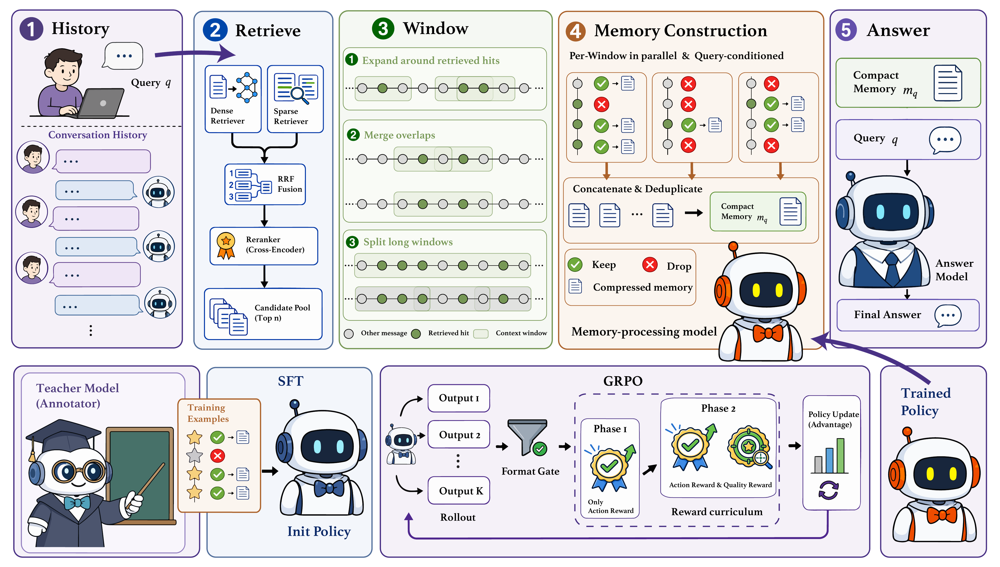
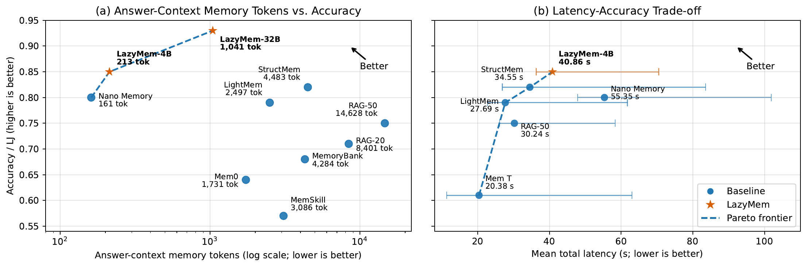
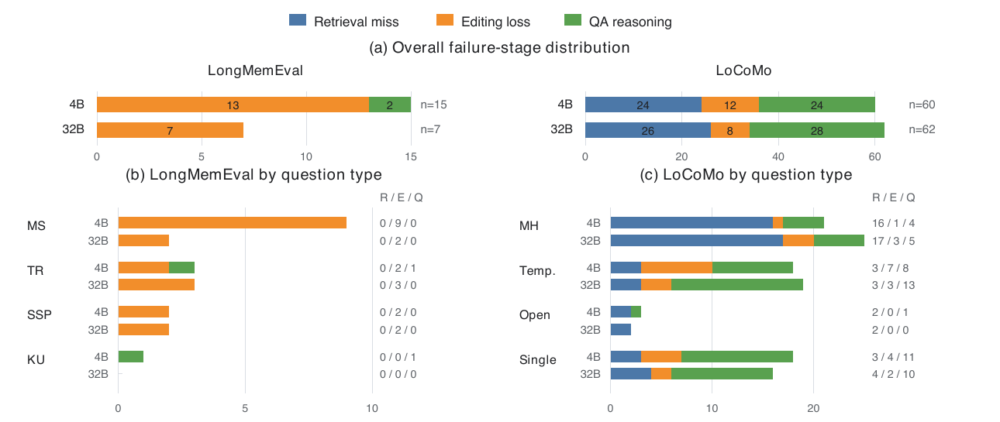

# LazyMem

**Retrieve Broadly, Construct Selectively for Efficient Long-Term Agent Memory**

> **Anonymous submission.** This repository accompanies a paper currently
> under double-blind review. Author names, affiliations, persistent project
> links, and identifying acknowledgements are intentionally omitted. Citation
> information will be added after the review process.

LazyMem is a retrieve-then-construct memory system for long-term conversational
agents. It stores interaction histories verbatim and postpones lossy memory
construction until a query arrives. At query time, LazyMem retrieves a broad
candidate pool, restores local conversational context, and uses a lightweight
memory-processing model to retain and compress only the evidence needed by the
current query.

The released code covers message ingestion, hybrid retrieval, history
windowing, teacher annotation, supervised fine-tuning (SFT), GRPO training, and
downstream QA evaluation. Datasets, model weights, generated annotations,
checkpoints, caches, and experiment outputs are not included.

## Method overview

<p align="center">
  
</p>

<p align="center"><em>
LazyMem retrieves broad evidence from raw interaction history and constructs
compact, query-specific memory only when a query arrives.
</em></p>

LazyMem has four query-time stages:

1. **Retrieve broadly.** Dense retrieval and BM25 run over raw messages. Their
   rankings are combined with Reciprocal Rank Fusion (RRF), then scored by a
   cross-encoder reranker.
2. **Restore local context.** Each retrieved message is expanded with nearby
   messages. Overlapping spans are merged, and long spans are split into
   bounded, overlapping sub-windows.
3. **Construct selectively.** A Qwen3-4B memory-processing model independently
   assigns `KEEP` or `DROP` to each message. Kept messages are rewritten into
   query-conditioned compressed evidence.
4. **Answer.** Kept evidence is deduplicated, ordered chronologically, and
   supplied to a frozen answer model together with the query.

The paper configuration retrieves 50 messages, uses a history radius of 2,
caps each sub-window at 8 messages, and uses stride 7. Independent windows can
be processed concurrently.

## Training

The memory-processing model is trained in two stages:

- **SFT** teaches the output schema, per-message `KEEP`/`DROP` behavior, and
  basic query-conditioned compression.
- **GRPO Phase 1** uses only the rule-based action reward. It does not call an
  LLM judge.
- **GRPO Phase 2** begins once global validation format accuracy is strictly
  greater than `0.99`. The transition is latched permanently, including across
  process restarts, and activates the quality reward.

For a valid output, the action reward is

```math
R_{\mathrm{act}} = \eta A_{\mathrm{g}} + (1-\eta)A_{\mathrm{n}},
```

where \(A_{\mathrm{g}}\) is gold-message `KEEP` accuracy,
\(A_{\mathrm{n}}\) is non-gold-message `DROP` accuracy, and
\(\eta=0.915\). If a window contains only one category, its category accuracy
is used directly.

In Phase 2, the final reward is

```math
R = \mathbb{I}[\text{valid format}]
\left((1-\lambda_{\mathrm{qual}})R_{\mathrm{act}}
+ \lambda_{\mathrm{qual}}R_{\mathrm{qual}}\right),
```

with \(\lambda_{\mathrm{qual}}=0.5\). The implementation uses the format
indicator as a multiplicative gate; the line break above is only for Markdown
rendering. Invalid outputs receive zero reward and never invoke the quality
judge. See [`docs/reward.md`](docs/reward.md) for the complete definition.

## Reported results

The anonymous manuscript reports the following headline results:

| Setting | Benchmark | LLM-judge accuracy | Answer-context memory |
|---|---:|---:|---:|
| LazyMem-4B | LongMemEval | 0.85 | 213 tokens |
| LazyMem-4B, zero-shot transfer | LoCoMo | 0.68 | — |

On LongMemEval, LazyMem-4B uses 68.7 times fewer answer-context memory tokens
than RAG Top-50 and 21.0 times fewer than the strongest reported non-oracle
baseline, while achieving higher answer accuracy. LoCoMo is used only for
out-of-domain testing; it is excluded from SFT and RL.

<p align="center">
  
</p>

<p align="center"><em>
Accuracy–efficiency trade-offs on LongMemEval. Error bars in the latency panel
show standard deviations across questions.
</em></p>

### Failure analysis

<p align="center">
  
</p>

<p align="center"><em>
Failure attribution separates retrieval misses, memory-editing losses, and
downstream QA reasoning errors.
</em></p>

On LongMemEval, most residual errors come from memory editing after the
necessary evidence has already been retrieved. LoCoMo failures are more evenly
distributed across retrieval and downstream reasoning, highlighting the
remaining dependence on candidate recall and the frozen answer model.

## Repository layout

```text
.
├── active_rl/       # Final reward implementation and GRPO launcher
├── assets/          # Figures reproduced from the anonymous manuscript
├── data_pipeline/   # Window construction and SFT/RL/test data preparation
├── docs/            # Reward and data-format documentation
├── evaluation/      # Memory-output conversion, QA generation, and judging
├── patches/         # Required VERL 0.7.1 patches
├── prompts/         # Teacher-annotation prompt templates
├── requirements/    # Pipeline and training dependencies
├── retrieval/       # Qdrant ingestion, experiment-15 retrieval, ripple eval
├── scripts/         # VERL patching and reward-judge serving
├── sft/             # LLaMA-Factory configuration and SFT validation
└── tests/           # Reward and QA-prompt regression tests
```

## Environment

The training configuration was verified with:

| Component | Version |
|---|---:|
| Python | 3.10.20 |
| PyTorch | 2.9.1 |
| Transformers | 4.57.6 |
| vLLM | 0.14.0 |
| VERL | 0.7.1 |
| Ray | 2.55.1 |
| LLaMA-Factory | 0.9.3 |

Create an isolated environment and install the packaged dependencies:

```bash
conda create -n lazymem python=3.10 -y
conda activate lazymem
pip install -r requirements.txt
```

Install LLaMA-Factory 0.9.3 separately for SFT, following its official
installation instructions.

LazyMem requires two small VERL changes for globally aggregated validation
metrics and count-based action statistics:

```bash
bash scripts/apply_verl_patches.sh --check
bash scripts/apply_verl_patches.sh
```

The paper experiments use one node with two 80 GB GPUs for SFT and GRPO. The
Qwen3-32B reward judge is served on one 80 GB GPU.

## Models and length settings

The main model roles are intentionally different:

| Role | Paper model | Relevant default |
|---|---|---:|
| Dense retriever | Qwen3-Embedding-8B | 4096-dimensional vectors |
| Reranker | BGE-Reranker-v2-M3 | 100 fused candidates |
| Annotation teacher | DeepSeek-V4-Flash | 4096 output tokens |
| Memory-processing policy | Qwen3-4B | 8192 prompt / 3072 RL response |
| Reward quality judge | Qwen3-32B | 1024 output / 512 thinking tokens |
| Frozen answer model | Qwen3-32B | 512 output tokens in the QA runner |

The reward-judge serving script uses a 16,384-token model context. The generic
Parquet inference runner uses a 12,288-token context with at most 3,072 output
tokens, which covers the RL limit of 8,192 prompt tokens plus 3,072 response
tokens.

## Data

Download LongMemEval and LoCoMo from their official releases. Keep benchmark
data outside Git; the repository ignores `data/` and all generated artifacts.
A convenient local layout is:

```text
data/
├── Benchmark/
│   ├── LongMemEval/data/longmemeval_s_cleaned.json
│   └── locomo/data/locomo10.json
├── processed/
├── reward/
└── splits/
    ├── sft_train_100.txt
    ├── train.txt
    ├── val.txt
    └── test.txt
```

The paper uses a type-stratified LongMemEval split of 360/40/100
train/validation/test questions with seed 42. The test split must not be used
for annotation, training, hyperparameter selection, or checkpoint selection.
See [`docs/data_format.md`](docs/data_format.md) for the VERL reward fields.

## External services

The end-to-end pipeline expects:

- a Qdrant server for message vectors;
- an OpenAI-compatible Qwen3-Embedding-8B endpoint;
- a BGE-Reranker-v2-M3 endpoint;
- an OpenAI-compatible teacher endpoint for SFT annotation;
- a Qwen3-32B endpoint for Phase-2 quality rewards;
- an answer-model endpoint for downstream QA evaluation.

All hostnames, ports, API keys, and served model names can be overridden through
CLI arguments or environment variables. Never commit credentials.

## Reproducing the pipeline

The commands below set paper-specific values explicitly. Adjust paths, hosts,
ports, and credentials for your environment.

### 1. Ingest raw messages

Start Qdrant and an embedding endpoint, then ingest each benchmark:

```bash
python retrieval/ingest_longmemeval.py \
  --data-path data/Benchmark/LongMemEval/data/longmemeval_s_cleaned.json \
  --host localhost

python retrieval/ingest_locomo.py \
  --data-path data/Benchmark/locomo/data/locomo10.json \
  --host localhost
```

The ingest stage embeds only raw message text and metadata. It does not create
LLM tags, traditional tags, query rewrites, or persistent summaries.

### 2. Run experiment-15 retrieval

```bash
export RERANK_MODEL=/path/to/BAAI/bge-reranker-v2-m3

python retrieval/retrieved.py \
  --data-file data/Benchmark/LongMemEval/data/longmemeval_s_cleaned.json \
  --host localhost \
  --rerank-backend local \
  --rerank-model "$RERANK_MODEL" \
  --rerank-device cuda \
  --save-topn 50 \
  --key-output-dir outputs/retrieval/longmemeval/exp15 \
  --overwrite

python retrieval/retrieved_locomo.py \
  --data-file data/Benchmark/locomo/data/locomo10.json \
  --host localhost \
  --rerank-backend local \
  --rerank-model "$RERANK_MODEL" \
  --rerank-device cuda \
  --save-topn 50 \
  --key-output-dir outputs/retrieval/locomo/exp15 \
  --overwrite
```

Experiment 15 is `CE-Hybrid-Raw`:

```text
raw query dense retrieval + raw query BM25
                    ↓
                  RRF
                    ↓
          BGE cross-encoder reranking
```

The cross-encoder runs locally and requires no reranking API key. The model
argument may be a local directory or a Hugging Face model identifier. The
pipeline contains no query-understanding or query-rewriting stage.

### 3. Build history windows

For the paper setting, explicitly use radius 2, maximum length 8, and stride 7:

```bash
python data_pipeline/build_longmemeval_windows.py \
  --data-file data/Benchmark/LongMemEval/data/longmemeval_s_cleaned.json \
  --retrieval-file outputs/retrieval/longmemeval/exp15/retrieval_details_include_72cases.jsonl \
  --retrieval-exp-id 15 \
  --top-k 50 \
  --context-window 2 \
  --max-window-messages 8 \
  --stride 7 \
  --out-file data/processed/top50_ctx2_windows.jsonl \
  --private-file data/processed/top50_ctx2_windows_private.jsonl \
  --stats-file outputs/data/top50_ctx2_window_stats.jsonl \
  --overwrite

python data_pipeline/build_locomo_windows.py \
  --data-file data/Benchmark/locomo/data/locomo10.json \
  --retrieval-file outputs/retrieval/locomo/exp15/retrieval_details_locomo.jsonl \
  --retrieval-exp-id 15 \
  --top-k 50 \
  --context-window 2 \
  --max-window-messages 8 \
  --stride 7 \
  --out-file data/processed/locomo_top50_ctx2_windows.jsonl \
  --private-file data/processed/locomo_top50_ctx2_windows_private.jsonl \
  --stats-file outputs/data/locomo_top50_ctx2_window_stats.jsonl \
  --overwrite
```

Public window files contain only model-visible inputs. Private files contain
gold message indices and answers used for filtering and rewards.

### 4. Build and validate SFT annotations

Render teacher inputs for the selected LongMemEval SFT question IDs:

```bash
python data_pipeline/annotate_windows.py build-inputs \
  --windows data/processed/top50_ctx2_windows.jsonl \
  --ids data/splits/sft_train_100.txt \
  --system-prompt prompts/annotate_window_system.txt \
  --user-prompt prompts/annotate_window_user.txt \
  --output outputs/data/window_annotation_inputs.jsonl
```

Run the teacher in thinking mode:

```bash
# Start this in a separate terminal and keep it running for Phase 2.
export JUDGE_MODEL_PATH=/path/to/Qwen3-32B
export JUDGE_GPU=0
bash scripts/serve_judge.sh
```

```bash
python data_pipeline/annotate_windows.py annotate \
  --input outputs/data/window_annotation_inputs.jsonl \
  --output outputs/data/window_annotations.jsonl \
  --error-output outputs/data/window_annotation_errors.jsonl \
  --base-url http://127.0.0.1:8022/v1 \
  --model qwen-32b \
  --thinking \
  --max-tokens 4096 \
  --resume
```

Validate the annotations and convert accepted examples to LLaMA-Factory format:

```bash
python data_pipeline/validate_annotations.py \
  outputs/data/window_annotations.jsonl \
  --private-windows data/processed/top50_ctx2_windows_private.jsonl

python data_pipeline/prepare_window_dft_llamafactory_data.py \
  --annotation-file outputs/data/window_annotations.jsonl \
  --private-windows data/processed/top50_ctx2_windows_private.jsonl \
  --output-dir outputs/data/sft \
  --dataset-name lazymem_window_dft_train100_balanced \
  --mode balanced-train \
  --overwrite
```

Build the validation annotations from the held-out validation IDs:

```bash
python data_pipeline/annotate_windows.py build-inputs \
  --windows data/processed/top50_ctx2_windows.jsonl \
  --ids data/splits/val.txt \
  --system-prompt prompts/annotate_window_system.txt \
  --user-prompt prompts/annotate_window_user.txt \
  --output outputs/data/window_annotation_inputs_val.jsonl

python data_pipeline/annotate_windows.py annotate \
  --input outputs/data/window_annotation_inputs_val.jsonl \
  --output outputs/data/window_annotations_val.jsonl \
  --error-output outputs/data/window_annotation_errors_val.jsonl \
  --base-url http://127.0.0.1:8022/v1 \
  --model qwen-32b \
  --thinking \
  --max-tokens 4096 \
  --resume

python data_pipeline/validate_annotations.py \
  outputs/data/window_annotations_val.jsonl \
  --private-windows data/processed/top50_ctx2_windows_private.jsonl

python data_pipeline/prepare_window_dft_llamafactory_data.py \
  --annotation-file outputs/data/window_annotations_val.jsonl \
  --private-windows data/processed/top50_ctx2_windows_private.jsonl \
  --output-dir outputs/data/sft \
  --dataset-name lazymem_window_dft_val_balanced \
  --mode all \
  --overwrite
```

Then run SFT:

```bash
llamafactory-cli train \
  sft/configs/qwen4b_full_dft_thinking_train100_ds2.yaml
```

### 5. Start the shared Qwen3-32B service

One OpenAI-compatible Qwen3-32B service is shared by teacher annotation,
offline reasoning-evidence generation, and the online Phase-2 quality reward.
If the service started above is no longer running, restart it with:

```bash
export JUDGE_MODEL_PATH=/path/to/Qwen3-32B
export JUDGE_GPU=0
bash scripts/serve_judge.sh
```

The service uses one GPU and listens on `127.0.0.1:8022` under the served name
`qwen-32b`. Keep it running while completing the next steps. Phase 1 does not
call the service, but it must remain available before the format threshold is
crossed.

### 6. Generate reasoning evidence and prepare GRPO data

Generate the question-level evidence explanations used by the Phase-2 quality
reward:

```bash
python data_pipeline/generate_reasoning_evidence.py \
  --dataset-file data/Benchmark/LongMemEval/data/longmemeval_s_cleaned.json \
  --split-dir data/splits \
  --output-dir data/reward \
  --splits train val test \
  --endpoint http://127.0.0.1:8022/v1/chat/completions \
  --model qwen-32b \
  --workers 4
```

This writes
`data/reward/{train,val,test}/reasoning_qwen32b.split.jsonl`. The command is
resumable by default: existing non-empty question results are retained and only
missing questions are requested. Failed requests are recorded beside the
corresponding output and cause a nonzero exit so that incomplete reward data is
not silently accepted.

Then construct the VERL-compatible parquet files:

```bash
python data_pipeline/prepare_window_rl_data.py \
  --windows data/processed/top50_ctx2_windows.jsonl \
  --private-windows data/processed/top50_ctx2_windows_private.jsonl \
  --split-dir data/splits \
  --prompt-dir prompts \
  --reward-data-dir data/reward \
  --output-dir outputs/data/rl \
  --splits train val test \
  --formats parquet jsonl \
  --balance-train \
  --balanced-train-size 10000 \
  --seed 42
```

The paper balances the RL training set to 10,000 prompts: 5,000 gold-bearing
windows sampled with replacement and 5,000 non-gold-only windows sampled
without replacement. Validation and test rows are not resampled.

### 7. Run GRPO

```bash
cp .env.example .env
```

Edit `.env` and replace at least these values:

```bash
# .env
export MODEL_PATH=/path/to/lazymem-sft-checkpoint
export TRAIN_FILE=outputs/data/rl/train.parquet
export VAL_FILE=outputs/data/rl/val.parquet
export CUDA_VISIBLE_DEVICES=0,1
export OUTPUT_ROOT=outputs
```

Then launch:

```bash
source .env
bash active_rl/train_grpo.sh
```

The launcher fixes \(\eta=0.915\), uses 8 rollouts per prompt, and trains for
3 epochs with a global prompt batch size of 32. Checkpoints, judge caches,
validation metrics, and the persistent Phase-2 latch are written below
`OUTPUT_ROOT`.

For a genuinely fresh run, use a new `EXPERIMENT_NAME` or ensure that its
checkpoint directory and Phase-2 latch do not come from an older experiment.

### 8. Downstream QA evaluation

Run the trained memory-processing model over a Parquet split:

```bash
python evaluation/run_parquet_inference_io.py \
  --model /path/to/lazymem-checkpoint \
  --job outputs/data/rl/test.parquet outputs/validation_dumps/lazymem/test.jsonl
```

Convert all `KEEP` compressions for each query into one chronological QA prompt
file:

```bash
python evaluation/build_qa_prompts.py \
  --validation-root outputs/validation_dumps/lazymem \
  --out-dir outputs/evaluation/qa_prompts
```

This produces exactly:

```text
outputs/evaluation/qa_prompts/qa_prompts.jsonl
```

Run the frozen answer model:

```bash
python evaluation/run_qwen32b_qa.py \
  --input outputs/evaluation/qa_prompts/qa_prompts.jsonl \
  --output outputs/evaluation/qwen32b_qa_answers.jsonl \
  --base-url http://127.0.0.1:8001/v1 \
  --model qwen-32b \
  --overwrite
```

For LongMemEval, evaluate predictions with the benchmark-compatible LLM judge:

```bash
export DEEPSEEK_API_KEY="your-deepseek-api-key"

python evaluation/module2_llm_judge.py \
  --pred-file outputs/evaluation/qwen32b_qa_answers.jsonl \
  --ref-file data/Benchmark/LongMemEval/data/longmemeval_s_cleaned.json \
  --judge-api-key "$DEEPSEEK_API_KEY"
```

The evaluation script defaults to the paper setting:
`https://api.deepseek.com/v1` with `deepseek-v4-pro` at temperature 0.

## Tests

Run the regression suite and shell syntax checks before training:

```bash
python -m unittest discover -s tests -v
bash -n active_rl/train_grpo.sh
bash -n scripts/apply_verl_patches.sh
bash -n scripts/serve_judge.sh
```

The tests cover the fixed action weight, invalid-format judge suppression,
strict and persistent Phase-2 switching, the 8-message/stride-7 window policy,
paper-style RL balancing, metadata preservation across evaluation stages, and
single-file QA-prompt generation.

## Reproducibility notes

- The repository intentionally contains no benchmark data, proprietary
  annotations, API credentials, model weights, or experiment outputs.
- All generated artifacts are written under `data/` or `outputs/`, both ignored
  by Git.
- SFT and RL use only LongMemEval training/validation data. LoCoMo is test-only.
- Experiment 15 uses raw-query dense and sparse retrieval; there is no QU stage.
- Invalidly formatted rollouts receive zero reward and never call the LLM judge.
- Once Phase 2 is latched, later validation fluctuations do not return training
  to Phase 1.

## Citation

Citation metadata is intentionally withheld during anonymous review and will be
added after the review process.

## License

Licensing information will be added with the final public release. Third-party
datasets and models remain subject to their respective licenses and terms.
